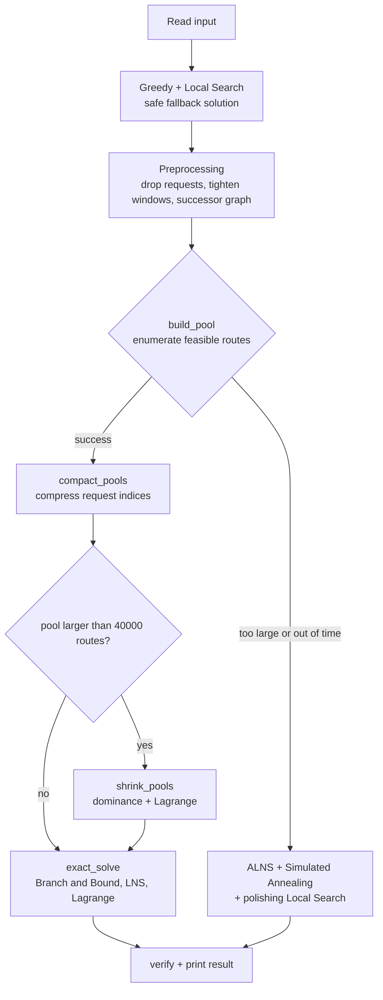

# Integrated Passenger and Parcel Transportation – SOICT 2026

A solver for the **integrated passenger and parcel transportation** problem (a taxi fleet carries both passengers and parcels and chooses which requests to serve to maximize profit), built for the **SOICT 2026** competition. Written in Python using only the standard library. It combines heuristics (Greedy, Local Search, ALNS) with route-based exact solving (route enumeration, Branch and Bound, LNS, Lagrangian upper bounds).


## Table of contents

1. [Problem description](#1-problem-description)
2. [Input / output format](#2-input--output-format)
3. [Approach](#3-approach)
4. [Repository layout](#4-repository-layout)
5. [Installation and usage](#5-installation-and-usage)
6. [Configuration](#6-configuration)
7. [Test suite and verification](#7-test-suite-and-verification)
8. [Results](#8-results)
9. [Limitations and notes](#9-limitations-and-notes)
10. [Team, license, references](#10-team-license-references)

## 1. Problem description

- There are **K taxis**. Taxi `k` starts at depot `O_k` at time `t = 0` and has capacity `Q_k`. It does not need to return to the depot.
- There are **N passenger requests** and **M parcel requests**. Each request has a pickup point `P`, a drop-off point `D`, a service time `S` and a revenue `T`. Serving every request is not mandatory.
  - **Passenger**: the taxi must arrive at the pickup within the window `[E, L]` (arriving early means waiting until `E`), then drive **directly** to the drop-off with no other stop in between. The drop-off has no time window. Passengers do not use capacity.
  - **Parcel** (weight `w`): has separate windows for pickup `[Ep, Lp]` and delivery `[Ed, Ld]`. The parcel uses `w` units of capacity from pickup until delivery and can share the taxi with other requests.
- Two `V × V` matrices, where `V = 2N + 2M + K`: travel time `T[u][v]` and cost `C[u][v]`. A taxi must go **directly** between two consecutive stops (the matrices must not be replaced by shortest paths through other nodes).
- **Objective**: maximize `Benefit = Σ revenue of served requests − Σ travel cost`.

## 2. Input / output format

**Input** (numbers separated by whitespace or newlines; vertices are numbered from 1; anything after `#` on a line is ignored):

```
K N M
depot_1 Q_1                      # K lines: depot vertex and capacity of each taxi
...
P D E L S T                      # N lines: passengers
...
P D w Ep Lp Ed Ld S T            # M lines: parcels
...
<V lines, V numbers each>        # time matrix T
<V lines, V numbers each>        # cost matrix C
```

**Output**:

```
Benefit
m_1 v_1 v_2 ... v_m1             # K lines: number of stops and the stop sequence of each taxi (depot omitted)
...
```

Example for `Test5` (K = 2, N = 2, M = 2), a valid solution with Benefit 217:

```
217
4 3 4 7 8
4 5 6 9 10
```

Taxi 1 carries passenger 3→4, then delivers parcel 7→8; taxi 2 carries passenger 5→6, then delivers parcel 9→10.

## 3. Approach



**Main idea.** On the real data the time windows are tight and every taxi starts at time 0, so each taxi has only tens to thousands of feasible routes. That makes it possible to enumerate them all and then pick the best set of routes (one route per taxi, each request in at most one route) with Branch and Bound. When enumeration is too large, the solver falls back to ALNS.

### 3.1 Initial solution (`greedy`, `local_search`)

- **Greedy**: each round inserts the (request, taxi, position) with the largest profit `revenue − added cost`, and stops when no insertion is profitable.
- **Local Search**: relocate / add / drop unprofitable requests, swap two requests between taxis, replace (swap a served request for an unserved one).
- Each route stores its departure times `dep`, loads `ld` and allowed slack `lat`, so every insertion position is checked in `O(1)` (`State.scan`). Scan results are cached per route version.
- This is also the fallback solution if the later stages run out of time.

### 3.2 Preprocessing (does not change the optimal value)

| Technique | Function / variable | Switch |
|---|---|---|
| Drop requests that cannot be served: multi-source Dijkstra from the depots gives the earliest arrival `amin`; requests with `amin > L`, or with `w` larger than every capacity, are removed | `alive_requests` | `SOICT_COMPRESS` |
| Tighten the parcel pickup window `L'_P = min(L_P, L_D − S_P − T[P][D])`; drop the request if `E_P > L'_P` (only when `metric_ok` finds the matrix close to the triangle inequality) | `build_pool` | always on |
| Successor graph: consider edge `u → P_r` only if the earliest departure time at `u` plus travel time still meets `L'_P` | `build_pool` (`dl`, `cand`) | always on |
| Sort candidates by `L'_P` ascending and use `bisect` to skip requests that are already past their deadline | `build_pool` (`candL`) | `SOICT_SORT` |
| Compress surviving request indices into `0..n-1` so bitmasks are shorter | `compact_pools` | `SOICT_COMPRESS` |
| Merge identical taxis (same capacity, same matrix rows from the depot): enumerate once, and break symmetry in B&B | `vehicle_groups`, `bnb` | `SOICT_SYM` |
| Drop dominated routes: route B is removed if the same taxi has a route A whose request set is a proper subset of B's and whose profit is not lower | `dominance_filter` | only runs when the pool exceeds `BIG_POOL` |

Not implemented: per-taxi (taxi, request) filtering, and splitting into independent components before B&B.

### 3.3 Route enumeration (`build_pool`)

A DFS enumerates every **complete** route (no parcel still on board at the end) that is profitable for each taxi, keeping only the highest-profit route for each (taxi, request set) pair. There are three levels, tried in order until one succeeds:

1. Full enumeration (up to 6 million states, 10% of the time budget).
2. At most 4 requests per route (30 million states, 16% of the time budget).
3. At most 3 requests per route (30 million states, 12% of the time budget).

If all three levels fail (or `MAX_ROUTES` is exceeded), the solver switches to ALNS.

### 3.4 Exact solving (`exact_solve`)

1. **Branch and Bound** picks a route for each taxi. The upper bound is the sum of the best still-compatible route of every unassigned taxi. If the search finishes, the result is optimal.
2. If it does not finish, the solver loops: **route-level LNS** (pick a random group of taxis and re-solve that group exactly) → **Lagrangian upper bound** (relax the constraint that each request is in at most one route, optimized by subgradient) → **route elimination** of routes that cannot improve the current solution (`fix_pools`) → B&B on the reduced pool, until optimality is proven or time runs out.
3. If the pool exceeds `BIG_POOL` (40 000 routes), `shrink_pools` first shrinks it with `dominance_filter` + LNS + Lagrange, keeping routes whose reduced profit (after subtracting the Lagrangian prices) is within `SHRINK · lb / K` of the taxi's best route. This step **is heuristic** and no longer guarantees optimality.

### 3.5 ALNS fallback (`alns`)

- **Destroy**: random, worst (lowest profit contribution), Shaw (close in space and time; two variants, seeded from a served or an unserved request).
- **Repair**: greedy insertion, regret-2, regret-3.
- Solutions are accepted by **Simulated Annealing** (temperature decreases geometrically with time), with adaptive operator weights (roulette selection), a reset to the best solution after a long stagnation, and a polishing Local Search at the end.

### 3.6 Output safety

- `verify` re-checks the solution from scratch against the rules before printing. An invalid solution is discarded and the fallback solution is used.
- A `SIGALRM` watchdog at `HARD` (290 seconds) prints the best verified solution and exits. Windows has no `SIGALRM`, so the watchdog disables itself there (without raising an error).

## 4. Repository layout

```
.
├── Code python/
│   └── solution.py          # the solver (single file, standard library only)
├── Test Case/
│   └── Test1.txt ... Test8.txt   # 8 real tests (Test5 is the sample test, not scored)
├── soict_test/              # extreme-case and regression test suite (see section 7)
│   ├── gen_tests.py         # generates 30 extreme / large tests
│   ├── checker.py           # independent checker
│   ├── harness.py           # runs the solution like the judge, measures time + RAM
│   ├── run_suite.py         # runs the whole suite and writes a report table
│   ├── regression.py        # compares the 8 real tests against the baseline scores
│   └── baseline.json        # baseline total 27738 and per-test baseline scores
└── File tài liệu/           # problem statement, work plans, reference material
```


## 5. Installation and usage

Requires **Python 3.8 or newer** (tested with 3.12 and 3.13). No external libraries are needed.

```bash
# read stdin, write stdout (the way a judge usually runs it)
python "Code python/solution.py" < input.txt > output.txt

# or pass file paths: argument 1 = input, argument 2 = output
python "Code python/solution.py" input.txt output.txt
```

Quick trial run (time limit of 20 seconds instead of 270 seconds):

```powershell
# PowerShell (Windows)
$env:SOICT_TL = 20
python "Code python/solution.py" "Test Case/Test1.txt" out1.txt
```

```bash
# Linux / macOS
SOICT_TL=20 python3 "Code python/solution.py" "Test Case/Test1.txt" out1.txt
```

## 6. Configuration

Set through environment variables. The remaining constants can be edited at the top of `solution.py`.

| Name | Default | Meaning |
|---|---|---|
| `SOICT_TL` | `270` | Time mark (seconds) at which the search stages stop. The competition allows 300 seconds per test |
| `SOICT_SORT` | `1` | `0` disables sorting candidates by `L'_P` + `bisect` |
| `SOICT_SYM` | `1` | `0` disables merging identical taxis and symmetry breaking |
| `SOICT_COMPRESS` | `1` | `0` disables dropping requests with `amin` and compressing request indices |
| `HARD` (constant) | `290` | Watchdog mark: print the solution and exit |
| `BIG_POOL` (constant) | `40000` | Route-count threshold that triggers `shrink_pools` |
| `SHRINK` (constant) | `0.16` | Width of the band of routes kept when shrinking the pool |
| `MAX_ROUTES` (constant) | `260000` | Maximum number of routes during enumeration; beyond it that level is abandoned |

## 7. Test suite and verification

The `soict_test/` folder needs only Python 3.8+ and is run from the repository root.

```bash
python soict_test/gen_tests.py                          # generate 30 tests into soict_test/tests/ (~95 MB)
python soict_test/run_suite.py --tl 20                  # run the whole suite, write soict_test/report/report.md
python soict_test/run_suite.py --full --only big        # the solution's real time limit, used to measure RAM
python soict_test/regression.py --full --record         # record baseline scores (when the total is exactly 27738)
python soict_test/regression.py --full                  # after every code change: must be GREEN
```

- **Generated tests** include: K = 1, passengers only, parcels only, very tight / very wide time windows, a demand peak (every `E` in `[0, 10]`), `Q = 1`, asymmetric matrices, all distances equal to 0, no profitable request, all windows unreachable, and large tests up to `K = 300`, `N = M = 300` (`V = 1400`). Some tests have a known answer (0 or the total revenue), so the report flags `SAI_ĐÁP_ÁN` (wrong answer) on a mismatch.
- **The checker** (`checker.py`) is written independently of `solution.py`: it rebuilds every route from the output and checks time windows, capacity, pickup/delivery order, passengers riding directly, and that the declared Benefit matches the recomputed one.
- **The regression suite** runs the 8 real tests, compares them with `baseline.json` and reports red (exit code 1) if a score deviates. Scores depend on run time, so record the baseline and compare on the same machine with the same `--full` or `--tl`.
- `soict_test/tests/` and `soict_test/report/` should go into `.gitignore` because they are large.

## 8. Results

Baseline scores on the 8 real tests (from the team's notes; the total over the 7 scored tests is **27 738**, recorded as a proven optimum):

| Test | K | N | M | Score |
|---|--:|--:|--:|--:|
| Test1 | 10 | 50 | 50 | 4285 |
| Test2 | 20 | 120 | 120 | 13279 |
| Test3 | 3 | 5 | 5 | 491 |
| Test4 | 5 | 15 | 15 | 1530 |
| Test5 (sample, not scored) | 2 | 2 | 2 | 217 |
| Test6 | 2 | 3 | 3 | 283 |
| Test7 | 6 | 25 | 25 | 2168 |
| Test8 | 10 | 47 | 48 | 5702 |
| **Total (without Test5)** | | | | **27738** |


## 9. Limitations and notes

- **Optimality is only guaranteed** when `build_pool` runs at the full level, `shrink_pools` does not run, and `exact_solve` finishes before the deadline. On large tests (where routes cannot be enumerated) the result is heuristic.
- `solution.py` runs against the wall clock, so scores may differ slightly between machines and runs when optimality has not been proven. According to the team's notes, the judge machine is about 2.5 times slower than the development machine.
- `metric_ok` checks the triangle inequality on 30 000 randomly sampled triples, not exhaustively.
- The matrices `T` and `C` are **not** replaced by their shortest-path closure (Floyd–Warshall): a taxi must go directly between two consecutive stops.
- Memory grows with `V²` because the two matrices are stored as lists

## 10. Team, license, references

- **Members**: 
- **Instructor / institution**: 
- **License**: 
- **References**: 
